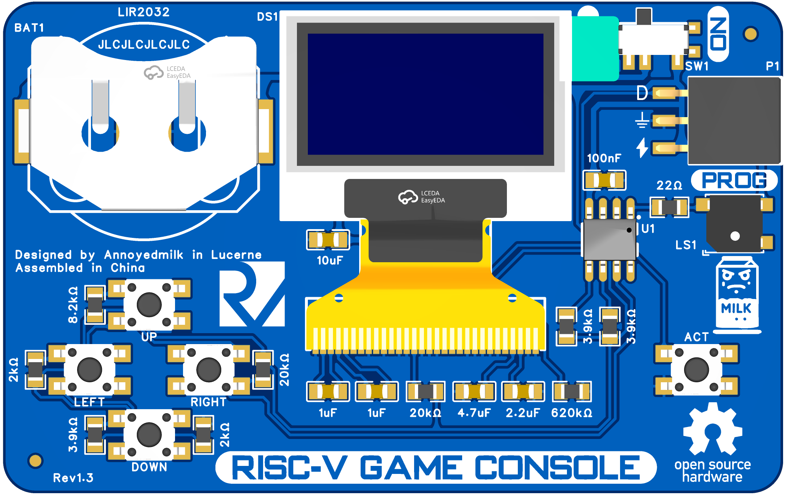
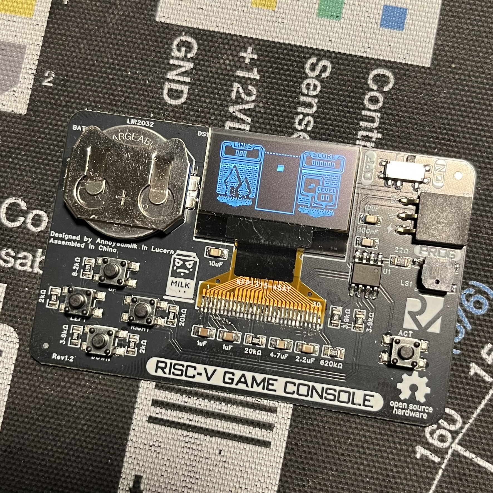

# Business Card

A business-card-sized handheld games console built around the CH32V003
RISC-V microcontroller: a 0.96" I2C OLED, five buttons, a piezo buzzer
and a rechargeable LIR2032 coin cell. It runs Tiny Tris, Tiny Pacman and
a hardware test mode, ported from the TinyJoypad project.

Hardware and firmware are released under GPL-3.0. See `LICENSE`.

## Hardware

| Function     | Part                    | Notes                                          |
| ------------ | ----------------------- | ---------------------------------------------- |
| MCU          | CH32V003J4M6            | RV32EC, 16K flash, 2K SRAM, SOP-8              |
| Display      | X096-2864KSWAG01-H30    | 0.96" 128x64 OLED, SSD1315, I2C                |
| Buttons      | 5x TS110926045          | 4 directions on a resistor ladder, 1 action    |
| Audio        | MLT-5030                | Piezo buzzer                                   |
| Power        | 3034TR holder + LIR2032 | Coin cell, SK-3296S-01-L1 slide switch         |
| Programming  | X6511FRS-03-C85D30      | 3-pin header P1: VCC, SWIO, GND                |

The SOP-8 package leaves few pins: PA1 buzzer, PA2 action button, PC1/PC2
OLED I2C, PC4 direction buttons (ADC ladder). The remaining pin carries
SWIO, brought out on P1 for programming.

The LIR2032 is rechargeable but there is no charger on the board; charge
the cell externally.

`hardware/` contains the EasyEDA project, schematic PDF, Gerbers, BOM,
pick-and-place data, an interactive BOM and a STEP model. To build a
board, send `Gerber.zip` to a fabricator and order the parts in
`BOM.csv`.

## Firmware

Bare-metal C on [ch32fun](https://github.com/cnlohr/ch32fun), vendored
as a submodule. No vendor SDK.

    software/
      Makefile            Build configuration
      funconfig.h         ch32fun configuration (clock, SysTick)
      COPYING.txt         GPL-3.0 text
      ld/ch32v003.ld      Linker script; reserves the high-score flash page
      ch32fun/            Submodule
      bin/                Build products; created by make, not in git
      src/
        main.c            Startup and the game-state loop
        tetris.c/.h       Tiny Tris, and the high-score record in flash
        pacman.c/.h       Tiny Pacman
        testmode.c/.h     Hardware test mode
        ui.c/.h           Menu, font, startup logo, jingle
        input.c/.h        Buttons, direction pad, buzzer, PRNG
        sprite.c/.h       Sprite blitter, shared by both games
        timing.c/.h       Frame pacing
        i2c_tx.c/.h       Transmit-only I2C master
        oled_min.c/.h     Minimal SSD1315 driver
        spritebank.c/.h   Sprite and bitmap data

The core runs at 24 MHz and the I2C bus at 1 MHz. Game speed does not
depend on either: `frame_sync()` in `timing.c` holds each pass of a game
loop to a fixed period, since the ATtiny originals carry no frame timing
of their own. The periods themselves are calibration values, tuned by
feel rather than measured from an ATtiny; see `timing.h`.

Rationale for the clocking, pacing and data compression is commented
where each lives: `funconfig.h`, `timing.h`, `i2c_tx.h` and
`spritebank.c`.

### Build

    git submodule update --init
    cd software
    make

Needs GNU Make and a RISC-V GCC on `PATH`; the
[xPack riscv-none-elf-gcc](https://github.com/xpack-dev-tools/riscv-none-elf-gcc-xpack/releases)
works without an installer (on Windows, unpack it to a short path).
Output: `software/bin/main.bin`. `make clean` removes `software/bin`.

### Flash

    make flash

drives a WCH-LinkE via the bundled minichlink, over the 3-pin header P1
(VCC, SWIO, GND).

`make flash` builds minichlink from source on first use, so it also needs
a host C compiler and libusb - on Windows, an MSYS2 MinGW environment.
minichlink further needs the WinUSB driver bound to WCH-Link interface 0
(installable with [Zadig](https://zadig.akeo.ie/)).

To avoid both, flash `main.bin` with WCH-LinkUtility instead, which uses
the stock driver and needs no build.

### Formatting

`.clang-format` at the repo root is the project standard: Allman braces,
two-space indent, and no column limit so nothing is reflowed. Editors
backed by clangd, Zed included, pick it up automatically; `make format`
applies it to the whole tree and `make format-check` verifies it. The
sprite tables in `spritebank.c` are hand-packed and excluded.

## Usage

Fit a charged LIR2032 and switch on. Up and down move through the menu,
the action button selects: Tiny Tris, Pacman, test mode, sound toggle.

- Tiny Tris: left/right move, action rotates, down soft-drops.
- Pacman: directions steer.
- Test mode: for board bring-up. A marker follows the direction pad and
  springs back to centre on release, an indicator lights while action is
  held, and a tone sweep on entry checks the buzzer. Hold action for
  about half a second to exit.

The Tiny Tris high score survives power-off: it is kept in the last
64-byte page of flash, which the linker script keeps out of the image.
The title screen shows the record; beating it at game over saves it.
Holding down while Tetris starts clears it.

## Credits

- Daniel C ([TinyJoypad](https://www.tinyjoypad.com)) - original Tiny
  Tris, Tiny Pacman and TESTMODE for the ATtiny85.
- Stefan Wagner ([@wagiminator](https://github.com/wagiminator)) - CH32V003
  port of Tiny Tris, I2C and OLED drivers.
- Charles Lohr ([@cnlohr](https://github.com/cnlohr)) - ch32fun and
  minichlink.
- Marco Müller - board design and CH32V003 game integration.
