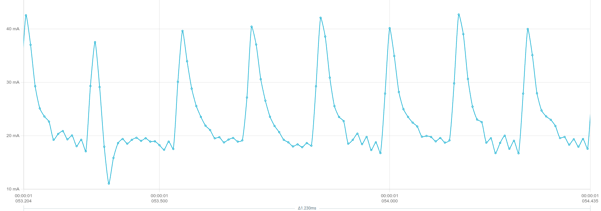

# Power Consumption Analysis 🔌

This document provides comprehensive power consumption measurements for the Business Card Gaming Console, essential for understanding battery life and operational characteristics.

## Test Equipment & Methodology

**Equipment Used:**
- [Nordic Power Profiler Kit II](https://www.nordicsemi.com/Products/Development-hardware/Power-Profiler-Kit-2)
- Method: Source Meter (Battery Disconnected)
- Supply Voltage: 3.6V (standard measurement voltage)

**Test Conditions:**
- Room temperature operation
- All measurements taken after device startup
- Each measurement represents sustained operation in the specified mode

## Power Consumption Results ⚡

The following measurements were conducted to characterize device operation:
- Current consumption across different operational modes
- Audio subsystem (buzzer) power requirements  
- Input system power impact
- Minimum operating voltage determination

### General Characteristics

**Current Ripple Behavior:**
- A consistent 150μs ripple pattern is observable at 6.6kHz frequency
- Current oscillates between approximately 20-40mA during operation
- This pattern likely corresponds to internal system clock/display update cycles

### Operational Mode Power Consumption 👾

| Mode | Average Current @ 3.6V | Power Consumption |
|------|-------------------------|-------------------|
| **Main Menu** | 21.4mA | 77.0mW |
| **Tetris Game** | 11.86mA | 42.7mW |
| **Pacman Game** | 9.58mA | 34.5mW |

**Key Observations:**
- Games consume less power than the main menu
- Pacman is the most power-efficient game mode
- Menu animations/effects contribute to higher power consumption

### Audio System Power Requirements 🔊

| Condition | Current Draw | Power @ 3.6V |
|-----------|--------------|---------------|
| **Buzzer Average** | 30-50mA | 108-180mW |
| **Buzzer Peak** | 120mA | 432mW |

### Input System Analysis 🕹️
- Button press events show no measurable change in current consumption
- Input processing is efficiently handled without additional power overhead

### Operating Voltage Range Analysis ⚡

**Test Conditions:** Main menu (idle state) after successful startup

| Voltage [V] | Avg Current [mA] | Peak Current [mA] | Status |
|-------------|------------------|-------------------|---------|
| 3.6 | 22.18 | 44.01 | ✅ Nominal operation |
| 3.5 | 21.39 | 43.9 | ✅ Stable operation |
| 3.4 | 21.31 | 42.07 | ✅ Stable operation |
| 3.3 | 21.38 | 41.41 | ✅ Stable operation |
| 3.2 | 21.34 | 38.24 | ✅ Stable operation |
| 3.1 | 21.36 | 34.99 | ✅ Stable operation |
| 3.0 | 21.44 | 30.48 | ✅ Stable operation |
| 2.9 | 24.01 | 28.07 | ✅ Stable operation |
| 2.8 | 23.57 | 26.65 | ✅ Stable operation |
| 2.7 | 22.63 | 25.67 | ✅ Stable operation |
| 2.6 | 21.69 | 24.59 | ✅ Stable operation |
| 2.5 | 20.95 | 23.52 | ✅ Stable operation |
| **2.45** | **20.52** | **23.22** | ⚠️ **Minimum stable voltage** |
| 2.4 | 15.95 | 18.46 | ❌ Display errors, buzzer malfunction |

**Key Findings:**
- **Minimum Operating Voltage:** 2.45V (stable operation)
- **Brownout Threshold:** Below 2.4V causes system instability
- **Recommended Minimum:** 2.5V for reliable operation with margin
- Current consumption remains relatively stable across voltage range until failure point

## Battery Life Estimation 🔋

**LIR2032 Specifications:**
- Capacity: ~40mAh typical
- Voltage: 3.0-4.2V operating range
- Chemistry: Lithium-ion rechargeable

**Estimated Runtime (at 3.0V):**
- Main Menu: ~1.9 hours continuous
- Tetris: ~3.4 hours continuous  
- Pacman: ~4.2 hours continuous
- Mixed usage: ~2-3 hours typical

*Note: Actual battery life will vary based on usage patterns, battery age, temperature, and individual cell characteristics.*

 